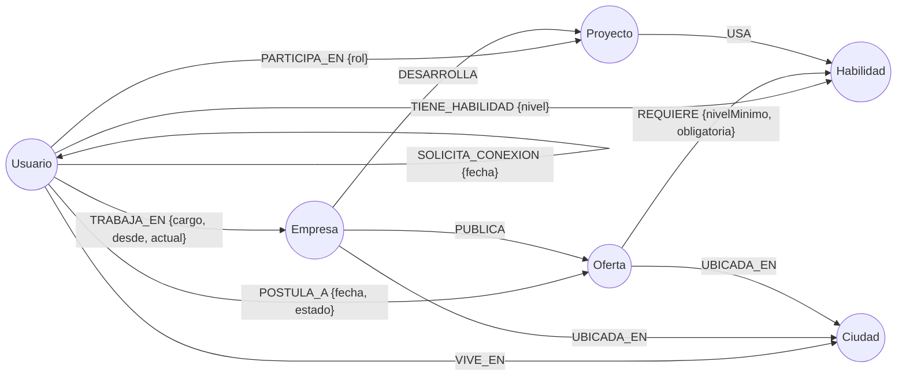

# Red Profesional sobre Grafos (Neo4j)

Proyecto I+D de Bases de Datos (Uninorte, 202610-2497): aplicación para gestionar y analizar
una red profesional usando una base de datos orientada a grafos.

**Stack:** Neo4j 5.26 + Graph Data Science · Node.js/TypeScript (neo4j-driver) · React

## Modelo del grafo



| Nodo | Propiedades |
|---|---|
| `Usuario` | id, nombre, email, titular, aniosExperiencia, abiertoAOfertas, creadoEn |
| `Empresa` | id, nombre, sector |
| `Habilidad` | id, nombre, categoria |
| `Proyecto` | id, nombre, descripcion, estado |
| `Oferta` | id, titulo, nivel, modalidad, estado, publicadaEn |
| `Ciudad` | id, nombre, departamento |

**Decisiones de modelado**

- `CONECTA_CON` es mutua: se guarda una sola vez y se consulta sin dirección `(a)-[:CONECTA_CON]-(b)`.
- Las solicitudes pendientes son otra relación (`SOLICITA_CONEXION`) y no una propiedad `estado`
  dentro de `CONECTA_CON`. Así, las consultas de red y los algoritmos (PageRank, Louvain) recorren
  solo conexiones reales sin filtrar, y Neo4j filtra por tipo de relación mucho más barato que por propiedad.
- `TRABAJA_EN.actual = false` guarda empleos anteriores: habilitan rutas y recomendaciones por excompañeros.
- Ciudad es un nodo (no un texto) para recomendar personas y ofertas cercanas recorriendo el grafo.
- Los datos semilla usan ids legibles (`usr-01`, `emp-03`, `of-06`) para la demo;
  lo que cree la app usará UUID (`randomUUID()`).

## Cómo levantarlo

Requisitos: Docker Desktop.

```bash
cp .env.example .env               # opcional: cambia la contraseña
docker compose up -d               # la primera vez descarga Neo4j y el plugin GDS
docker compose ps                  # espera a que diga "healthy"
```

Cargar el esquema y los datos semilla (PowerShell o terminal de Mac/Linux):

```bash
docker compose exec neo4j cypher-shell -u neo4j -p redprofesional123 -f /scripts/01_esquema.cypher
docker compose exec neo4j cypher-shell -u neo4j -p redprofesional123 -f /scripts/02_datos_semilla.cypher
```

En Git Bash, antepón `MSYS_NO_PATHCONV=1` a cada comando: si no, Git Bash convierte `/scripts/...` en
`C:/Program Files/Git/scripts/...` y `cypher-shell` responde "No such file or directory".

El último bloque de `02_datos_semilla.cypher` imprime el conteo esperado:
Ciudad 6 · Empresa 8 · Habilidad 29 · Oferta 15 · Proyecto 12 · Usuario 40.

Correr las consultas (13 en total, solo lectura; cada bloque trae un valor de ejemplo en `:param`):

```bash
docker compose exec neo4j cypher-shell -u neo4j -p redprofesional123 -f /scripts/03_consultas.cypher
```

Para ver el grafo: abre http://localhost:7474, entra con `neo4j` / tu contraseña y ejecuta
`MATCH (n) RETURN n`.

Para volver a empezar desde cero: `... -f /scripts/00_limpiar.cypher` y vuelve a cargar.

## Demo

El guion de la demo de 15 minutos, con preparación, qué decir, qué debe aparecer en pantalla y plan B por
bloque, está en [`docs/guion-demo.md`](docs/guion-demo.md). Las capturas de la app están en `docs/capturas/`.

```powershell
# Base limpia (110 nodos, 554 relaciones). -Ensayo recorre el guion en el navegador; -Benchmark prepara el camino en vivo.
powershell -ExecutionPolicy Bypass -File scripts\preparar-demo.ps1 -Ensayo -Benchmark
```

- `cd frontend && npm run ensayo`: el guion completo con Playwright, comprobando lo que debe verse. Va aparte
  de `npm run e2e` porque exige la semilla recién cargada; si no la encuentra, se niega y lo dice. Al terminar
  borra lo que creó.
- `cd benchmark && npm run demo`: el camino más corto en vivo con 100 000 personas, en las dos bases, con la
  respuesta comprobada contra el cálculo en memoria.

## Backend

API REST en Node.js + TypeScript (Express 5, Zod y `neo4j-driver`). Requiere Node 22 y Neo4j con la semilla cargada.

```bash
cd backend
cp .env.example .env               # la contraseña debe ser la misma de Docker
npm install
npm run dev                        # http://localhost:3000, se reinicia al guardar código o un .cypher de db/
```

Con `npm test` corren las pruebas contra el Neo4j local. No tocan los datos semilla: crean usuarios con
email `@prueba.test` y empresas, ofertas y proyectos con `[prueba]` en el nombre, y los borran al terminar.

| Método y ruta | Qué hace |
|---|---|
| `GET /salud` | Estado de la API y de la conexión a Neo4j |
| `POST /usuarios` | Crea un usuario |
| `GET /usuarios?busqueda=&pagina=&limite=` | Lista o busca por nombre y titular; tolera errores y tildes faltantes |
| `GET /usuarios/:id` | Perfil completo: habilidades, empleos, proyectos y conexiones |
| `PATCH /usuarios/:id` | Actualiza los campos enviados |
| `DELETE /usuarios/:id` | Borra el usuario y sus relaciones |
| `POST /usuarios/:id/solicitudes` | Envía una solicitud de conexión a `destinoId` |
| `GET /usuarios/:id/solicitudes` | Solicitudes pendientes recibidas y enviadas |
| `POST /solicitudes/aceptar` | Cambia la solicitud por una conexión (`solicitanteId`, `destinoId`) |
| `POST /solicitudes/rechazar` | Borra la solicitud sin conectar; sirve para rechazar o cancelar |
| `GET /usuarios/:id/relacion/:otroId` | Si están conectados o hay solicitud pendiente en algún sentido |
| `GET /usuarios/:id/conexiones?pagina=&limite=` | Lista los contactos del usuario |
| `PUT` / `DELETE /usuarios/:id/habilidades/:habilidadId` | Pone o quita una habilidad (`nivel` de 1 a 5) |
| `PUT` / `DELETE /usuarios/:id/empleos/:empresaId` | Pone o quita un empleo (`cargo`, `desde`, `actual`) |
| `PUT` / `DELETE /usuarios/:id/proyectos/:proyectoId` | Pone o quita una participación (`rol`) |
| `GET /usuarios/:id/postulaciones` | Postulaciones del usuario |
| `POST /empresas`, `GET /empresas?pagina=&limite=` | Crea o lista empresas |
| `GET` / `PATCH` / `DELETE /empresas/:id` | Perfil, cambios y borrado; con ofertas no se puede borrar (409) |
| `POST /ofertas`, `GET /ofertas?estado=&pagina=&limite=` | Crea o lista ofertas; toda oferta nace abierta |
| `GET` / `PATCH` / `DELETE /ofertas/:id` | Detalle, cambios (cerrarla es `estado: cerrada`) y borrado |
| `PUT` / `DELETE /ofertas/:id/habilidades/:habilidadId` | Pone o quita un requisito (`nivelMinimo`, `obligatoria`) |
| `POST /ofertas/:id/postulaciones` | Postula a `usuarioId`; no admite repetir ni ofertas cerradas (409) |
| `GET /ofertas/:id/postulaciones` | Postulantes de la oferta |
| `PATCH /ofertas/:id/postulaciones/:usuarioId` | Cambia el `estado` de la postulación |
| `POST /proyectos`, `GET /proyectos?pagina=&limite=` | Crea o lista proyectos; sin `empresaId` es comunitario |
| `GET` / `PATCH` / `DELETE /proyectos/:id` | Detalle con tecnologías y miembros, cambios y borrado |
| `PUT` / `DELETE /proyectos/:id/habilidades/:habilidadId` | Pone o quita una tecnología |
| `GET /ciudades`, `GET /habilidades` | Catálogos para los selectores del frontend |
| `GET /usuarios/:id/similares` | Usuarios con habilidades parecidas (Jaccard) |
| `GET /usuarios/:id/contactos-comunes/:otroId` | Contactos en común entre dos personas |
| `GET /usuarios/:id/ruta-empresa/:empresaId` | Camino más corto a una empresa; `ruta` es nula si no hay |
| `GET /usuarios/:id/ruta-oferta/:ofertaId` | Camino más corto a una oferta; `ruta` es nula si no hay |
| `GET /usuarios/:id/recomendaciones/contactos` | A quién conectar y por qué |
| `GET /usuarios/:id/recomendaciones/empleos` | Ofertas para el usuario, con lo que cumple y lo que falta |
| `GET /ofertas/:id/candidatos` | Candidatos con puntaje y explicación |
| `GET /proyectos/relacionados` | Proyectos que comparten tecnologías o miembros |
| `GET /proyectos/:id/colaboradores` | Personas para un proyecto en curso |
| `GET /analitica/influyentes` | Top 10 por PageRank |
| `GET /analitica/comunidades` | Comunidades detectadas con Louvain |
| `GET /analitica/habilidades` | Habilidades más demandadas en ofertas abiertas |
| `GET /analitica/grafo` | Personas, empresas y ofertas con sus enlaces, para dibujar la red |

Una consulta sin resultados responde 200 con lista vacía; 404 significa que el usuario, oferta, empresa o
proyecto no existe. La analítica de GDS recrea la proyección en cada llamada, así que siempre ve la red actual
y sobrevive a un reinicio de Neo4j. Las llamadas van en fila: cada Louvain tarda entre 0.6 y 1.2 s con la semilla.

Todo el Cypher vive en `db/`: el backend carga cada consulta por su marca `// @nombre`, así que lo que se
entrega es lo que corre la aplicación.

## Frontend

React + TypeScript con Vite. Requiere Node 22, el backend encendido y Neo4j con la semilla cargada.

```bash
cd frontend
npm install
npm run dev                        # http://localhost:5173
```

El navegador solo habla con Vite, que reenvía `/api` al backend: así hay un único origen y no hace falta CORS.
No hay login: el selector "Actuar como" de la cabecera elige a qué persona representas y se recuerda al recargar.

| Vista | Qué hace |
|---|---|
| Mi red | Solicitudes, conexiones, personas sugeridas y empleos para ti, cada uno con su porqué; postularse |
| Personas | Busca, crea, edita y borra personas. El perfil edita habilidades, empleos y proyectos, y frente a la persona representada muestra la relación, los contactos en común y quién se le parece |
| Empresas | Lista, crea, edita y borra empresas; el perfil muestra sus ofertas y proyectos |
| Ofertas | Filtra por estado; el detalle edita requisitos, cierra o reabre, recibe postulaciones, cambia su estado y sugiere candidatos con su porqué |
| Proyectos | Tecnologías y miembros editables, colaboradores sugeridos y las parejas de proyectos más relacionadas |
| Panel | Red coloreada por comunidad (Louvain), usuarios influyentes (PageRank) y habilidades demandadas |
| Caminos | Camino más corto de una persona a una empresa u oferta, resaltado en el grafo |

En Caminos se puede elegir sobre el dibujo: un clic en una persona la vuelve el origen, y en una empresa u oferta,
el destino.

Con `npm run e2e` corren las pruebas de extremo a extremo con Playwright sobre el Chrome instalado. Encienden
el backend y Vite si hace falta, crean usuarios con email `@prueba.test` y los borran al terminar. No correrlas
a la vez que las del backend: comparten esa limpieza.

## Benchmark grafo vs relacional

Compara Neo4j con PostgreSQL sobre los mismos datos, para responder con números la parte de investigación.
Usa sus propios contenedores, así que la base de la demo no se toca:

```bash
docker compose --profile benchmark up -d   # Neo4j en 7475/7688 y PostgreSQL en 5433
cd benchmark
npm install
npm run generar -- 10000                    # escribe los CSV en benchmark/datos/10000/
npm run cargar -- 10000                     # carga los mismos CSV en las dos bases y compara
npm run medir -- 10000                      # mide las 14 consultas; o solo algunas: medir -- 10000 camino
npm run graficas                            # gráficas (SVG y PNG) y tablas desde los resultados
npm run demo                                # camino más corto en vivo con 100 000 personas (para la demo)
```

**Resultados y conclusiones: [`benchmark/RESULTADOS.md`](benchmark/RESULTADOS.md).** En resumen, el grafo gana
al recorrer varios saltos (975 veces en el camino más corto con 100 000 personas) y el relacional en consultas
cortas, agregaciones y carga masiva.

`medir` corre cada consulta en las dos bases con las mismas entradas. Las 5 primeras sirven para calentar y
para verificar: si las bases no responden lo mismo (o lo que da la red calculada en memoria), se detiene sin
medir. Luego cronometra 30 entradas distintas por base, con un límite de 60 s, y guarda mediana, p95, mínimo y
máximo en `resultados/consultas-<escala>.json` y los planes (`PROFILE` y `EXPLAIN ANALYZE`) en
`resultados/planes-<escala>/`. El tiempo se toma en el cliente, de enviar a recibir todas las filas: por eso la
primera consulta es trivial (`RETURN 1` / `SELECT 1`) y muestra el costo fijo de hablar con cada base.

El generador usa semilla fija: misma escala, misma red. Forma comunidades por ciudad (85 % de las conexiones
quedan dentro de una) y prefiere conectar con quien ya tiene más contactos, así salen unas pocas personas
muy conectadas, como en una red real. La carga se detiene con error si alguna base no queda con exactamente
los conteos y huellas de `resumen.json`.

Las dos bases tienen 4 CPU, 5 GB de RAM y 2 GB de caché. En PostgreSQL cada conexión se guarda en los dos
sentidos y cada relación tiene índice por ambos extremos: se le da su mejor diseño para recorrer la red.

## Estructura

```
db/
  00_limpiar.cypher        borra todos los datos (no el esquema)
  01_esquema.cypher        constraints de unicidad, índices y búsqueda de texto completo
  02_datos_semilla.cypher  40 usuarios, 8 empresas, 12 proyectos, 15 ofertas (datos ficticios)
  03_consultas.cypher      preguntas del enunciado, recomendaciones, caminos y analítica GDS
  04_operaciones.cypher    escrituras de la aplicación (no se corre con -f)
backend/
  src/rutas/               HTTP y validación
  src/repositorios/        ejecutan el Cypher de db/
  tests/                   pruebas contra Neo4j real
frontend/
  src/api/                 cliente HTTP, tipos y consultas de React Query
  src/componentes/         marco, selector de persona y piezas comunes
  src/paginas/             una por vista
  e2e/                     pruebas con Playwright
benchmark/
  src/modelo.ts            generador de la red sintética
  src/cargar.ts            carga en las dos bases y verificación
  sql/                     esquema relacional equivalente
  cypher/carga.cypher      carga en Neo4j con LOAD CSV
  resultados/              tiempos de carga y, luego, de consultas
docker-compose.yml         Neo4j 5.26 + GDS; con --profile benchmark, Neo4j y PostgreSQL 17 aparte
```

## Datos semilla

Personas y empresas ficticias en seis ciudades de Colombia, organizadas en comunidades:

- **Caribe** (Barranquilla, Cartagena): frontend, full stack, logística
- **Bogotá**: datos y fintech
- **Medellín**: cloud/DevOps y diseño
- **Cali y Montería**: salud y agro

Algunos usuarios hacen de **puente** entre comunidades (por ejemplo `usr-02` Carlos Mejía,
`usr-15` Paula Moreno y `usr-21` Juliana Ospina): PageRank los ubica en los tres primeros puestos.
Louvain detecta 5 comunidades, no 4: separa Medellín en cloud/DevOps y diseño, que tienen 15
conexiones internas y solo 2 entre ellos.
`usr-39` y `usr-40` son usuarios nuevos sin conexiones, para mostrar recomendaciones a alguien
que recién llega a la red.
Cada una de las 14 ofertas abiertas tiene al menos un candidato disponible que cumple todas las
habilidades obligatorias.
