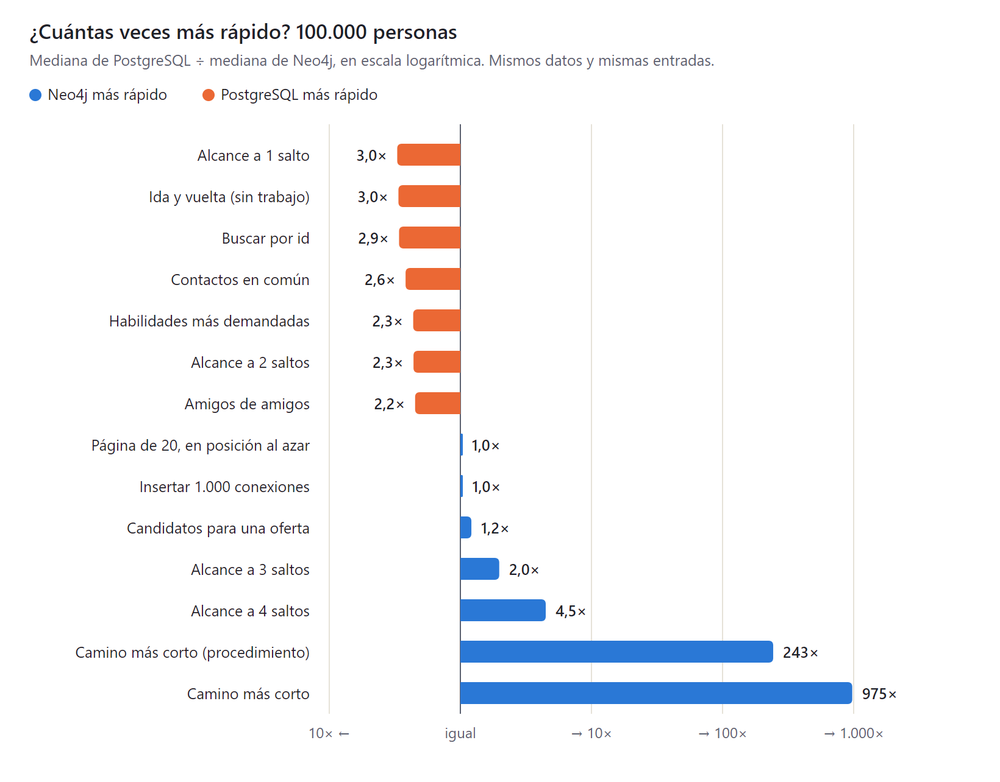
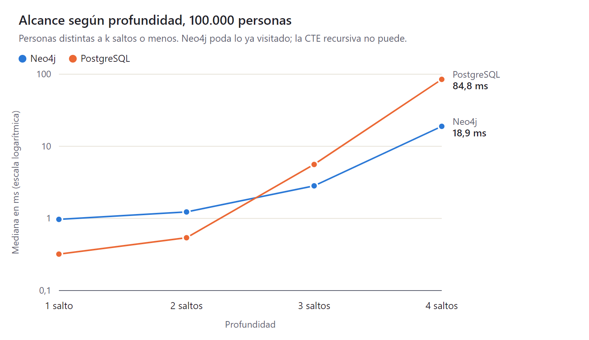
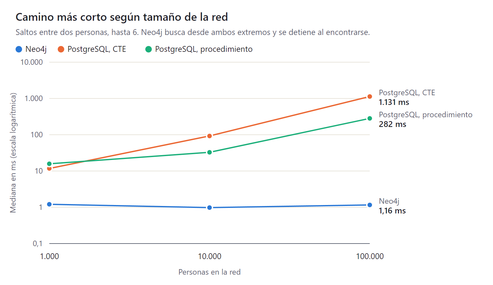
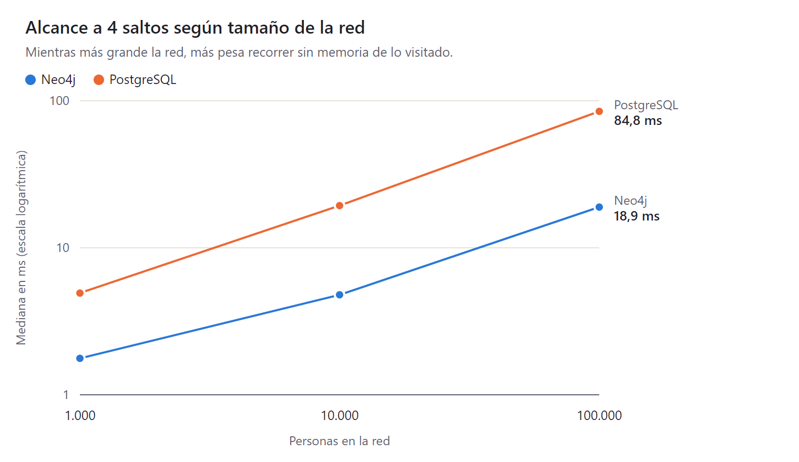

# Grafo vs relacional: resultados del benchmark

**Pregunta de investigación:** ¿en qué escenarios una base de datos de grafos supera a una relacional, y en
cuáles no?

**Respuesta corta, con los datos de este experimento:**

- **El grafo gana cuando la consulta recorre la red a varios saltos.** A 4 saltos Neo4j fue 4,5 veces más rápido
  con 100 000 personas, y en el camino más corto entre dos personas, 975 veces (243 veces frente al mejor
  procedimiento escrito en PostgreSQL). Su tiempo casi no cambia con el tamaño de la red: el camino más corto
  tarda alrededor de 1 ms con 1 000, 10 000 y 100 000 personas.
- **El relacional gana en consultas cortas y en agregaciones.** Buscar por id, contactos en común o vecinos a
  1 y 2 saltos fueron de 2 a 3 veces más rápidos en PostgreSQL, pero casi toda esa diferencia es el costo fijo
  de hablar con cada base: 0,9 ms Neo4j y 0,3 ms PostgreSQL por petición, aun sin trabajo. Contar qué
  habilidades piden más las ofertas fue 2,3 veces más rápido en PostgreSQL, y cargar datos masivos, 3 veces.
- **Empatan** en la consulta de candidatos, que combina muchos joins acotados, y en escribir 1 000 conexiones
  con 100 000 personas.

## Cómo se midió

| Aspecto | Decisión |
|---|---|
| Bases | Neo4j 5.26.32 Community y PostgreSQL 17.11, cada una en su contenedor con 4 CPU, 5 GB de RAM y 2 GB de caché |
| Equipo | Intel Core i9-14900K, 32 GB de RAM, Windows 11 con Docker Desktop |
| Datos | Red sintética con semilla fija, a 1 000, 10 000 y 100 000 personas. Comunidades por ciudad (85 % de las conexiones quedan dentro) y conexión preferencial, así unas pocas personas tienen muchos contactos (grado máximo 581 con 100 000) |
| Igualdad de datos | Los mismos CSV se cargan en las dos bases; la carga falla si alguna no queda con los conteos y huellas esperados |
| Diseño relacional | El mejor para recorrer: cada conexión guardada en los dos sentidos, índice por ambos extremos de cada relación, llaves foráneas |
| Igualdad de respuestas | Antes de medir, cada consulta corre 5 veces en las dos bases; si responden distinto, o distinto de lo calculado en memoria, no se mide |
| Medición | 30 entradas distintas por consulta y base, tras calentar. Se reporta mediana y p95. Límite de 60 s |
| Cronómetro | En el cliente, desde enviar la consulta hasta recibir todas las filas: lo que vería la aplicación |

Las 14 consultas, con su versión Cypher y SQL, están en [`src/consultas.ts`](src/consultas.ts).

## Resultados con 100 000 personas

Mediana de 30 mediciones, en milisegundos. Las tablas de las tres escalas, con p95, están en
[`resultados/tablas.md`](resultados/tablas.md).

| Consulta | Neo4j | PostgreSQL | Más rápido |
|---|---|---|---|
| Ida y vuelta, sin trabajo (`RETURN 1` / `SELECT 1`) | 0,92 | 0,31 | PostgreSQL 3× |
| Buscar por id | 0,91 | 0,31 | PostgreSQL 2,9× |
| Contactos en común | 0,89 | 0,34 | PostgreSQL 2,6× |
| Amigos de amigos (2 saltos, con conteo) | 1,24 | 0,56 | PostgreSQL 2,2× |
| Alcance a 1 salto | 0,97 | 0,32 | PostgreSQL 3× |
| Alcance a 2 saltos | 1,23 | 0,54 | PostgreSQL 2,3× |
| Alcance a 3 saltos | 2,83 | 5,6 | Neo4j 2× |
| Alcance a 4 saltos | 18,9 | 84,8 | Neo4j 4,5× |
| Camino más corto (hasta 6 saltos) | 1,16 | 1 131 (CTE) / 282 (procedimiento) | Neo4j 975× / 243× |
| Habilidades más demandadas | 6,87 | 3,0 | PostgreSQL 2,3× |
| Página de 20 en posición al azar | 4,70 | 4,84 | Empate |
| Candidatos para una oferta | 403 | 489 | Empate (Neo4j 1,2×) |
| Insertar 1 000 conexiones | 65 | 67 | Empate |









## Por qué: lo que dicen los planes de ejecución

Los planes completos están en `resultados/planes-<escala>/`: `PROFILE` de Neo4j y `EXPLAIN ANALYZE` de
PostgreSQL para una entrada de cada consulta.

- **Camino más corto.** Neo4j usa el operador `ShortestPath`: busca desde las dos personas a la vez y se detiene
  cuando las búsquedas se encuentran. Con 100 000 personas tocó 459 registros. La CTE recursiva de PostgreSQL no
  puede detenerse al encontrar el destino ni recordar a quién ya visitó en vueltas anteriores: recorre los 6
  niveles completos y produjo 257 073 filas. El procedimiento (`sql/funciones.sql`) sí lleva visitados y se
  detiene, y por eso es 4 veces mejor que la CTE, pero sigue haciendo un join con índice por cada salto.
- **Alcance a k saltos.** Neo4j usa `VarLengthExpand(Pruning, BFS)`: avanza por anchura y descarta a quien ya vio.
  Sus registros tocados crecen con la vecindad real: 11, 137, 1 882 y 35 636 de 1 a 4 saltos. La CTE vuelve a
  expandir a una persona cada vez que reaparece en otro nivel; la brecha crece con la profundidad.
- **Adyacencia sin índice** (*index-free adjacency*). Cada nodo de Neo4j guarda referencias directas a sus
  relaciones: pasar a un vecino cuesta lo mismo con mil o con un millón de personas. En PostgreSQL cada salto es
  una búsqueda en un índice B-tree, cuyo costo crece (poco) con el tamaño, y que se repite por cada fila de la
  frontera.
- **Consultas cortas.** Ambas resuelven con una búsqueda por índice y casi sin trabajo. La diferencia que queda
  es el protocolo: Bolt (Neo4j) cuesta unos 0,6 ms más por petición que el de PostgreSQL. Se comprobó que no es
  mal uso del driver: `npm run ida-y-vuelta` compara las formas de consultar y `session.run` es la más rápida.
- **Agregaciones.** Contar qué habilidades piden las ofertas abiertas recorre muchas filas y agrupa: es lo que
  un motor relacional hace desde hace décadas. Neo4j tocó 84 298 registros para lo mismo.
- **Candidatos.** Para una habilidad común hay miles de personas que la tienen, y para cada una se cuentan sus
  contactos en la empresa. Las dos bases hacen ese mismo trabajo (Neo4j tocó 4,4 millones de registros), así
  que empatan: la forma de la consulta no favorece a ninguna.

## Dónde gana cada uno

**Grafo (Neo4j):**

- Recorridos de varios saltos o de profundidad variable: caminos, alcance, "contactos de contactos de…".
- Cuando el costo debe depender de cuánto se toca y no del tamaño total de la base.
- Expresividad: el camino más corto son 4 líneas de Cypher; en SQL, una CTE que no se detiene o un procedimiento
  de 40 líneas.

**Relacional (PostgreSQL):**

- Búsquedas puntuales y consultas de uno o dos joins, sobre todo si la latencia de cada petición importa.
- Agregaciones sobre muchas filas: conteos, sumas, rankings.
- Carga masiva: `COPY` cargó 100 000 personas en 6 s frente a 17 s de `LOAD CSV`.
- Integridad referencial declarada (no medida aquí, pero sí vivida en el proyecto): las llaves foráneas impiden
  una conexión hacia alguien que no existe. En Neo4j eso lo hizo el backend a mano: por ejemplo, que una empresa
  con ofertas no se pueda borrar o que borrar a una persona se lleve sus postulaciones.

**Ninguno en especial:** consultas de muchos joins acotados, como la de candidatos, y escrituras de lotes
moderados.

## Amenazas a la validez

1. **El cronómetro incluye el protocolo.** Es lo que vive la aplicación, pero castiga a Neo4j en las consultas
   cortas. La fila de ida y vuelta permite descontarlo.
2. **Variación entre corridas.** Se midió dos veces la escala de 100 000 (la primera queda en
   `resultados/consultas-100000-corrida1.json`): las medianas variaron hasta un 38 % en las consultas cortas y un
   61 % en la CTE del camino, pero ninguna consulta cambió de ganador. Diferencias por debajo de 2 veces
   deben leerse como tendencia, no como resultado firme.
3. **Caché caliente.** Los datos caben en los 2 GB de caché de cada base y se midió tras calentar. Leyendo de
   disco los números serían otros.
4. **Algoritmo distinto en el camino más corto.** Neo4j busca desde ambos extremos; el procedimiento de
   PostgreSQL, desde uno. Un procedimiento bidireccional acortaría la brecha, a costa de más código.
5. **Un hilo por consulta en ambas.** Neo4j Community no paraleliza una consulta; PostgreSQL podría, pero
   ningún plan usó trabajadores en paralelo. Con más datos eso podría cambiar a favor de PostgreSQL en las
   agregaciones.
6. **Datos sintéticos, una sola máquina.** La red imita comunidades y personas muy conectadas, pero no es una red
   real, y Docker Desktop en Windows agrega su propia capa de red.
7. **La carga no es una prueba de escritura.** `LOAD CSV` busca nodos fila por fila; `COPY` indexa al final.
8. **Escala de curso.** El estándar de la industria para comparar bases de grafos es el LDBC Social Network
   Benchmark, con millones de nodos y muchas más consultas.

## Cómo reproducirlo

```bash
docker compose --profile benchmark up -d
cd benchmark
npm install
npm run generar -- 100000
npm run cargar -- 100000
npm run medir -- 100000        # unos 2 minutos con 100 000 personas
npm run graficas               # vuelve a generar gráficas y tablas desde los JSON
```

Cada escala necesita su propia carga antes de medir: `medir` comprueba que las bases tengan esa cantidad de
personas y se detiene si no.
